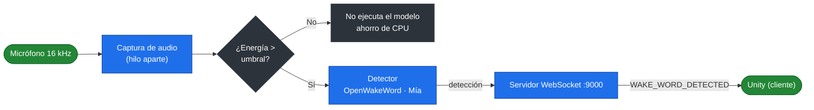

# it_wake_word — detección de la palabra de activación "Mía"

Microservicio de detección de palabra clave (*wake word*) del proyecto **Inclusive Tech**, un sistema domótico accesible desarrollado como proyecto de grado en la Fundación Universitaria Konrad Lorenz.

El servicio escucha el micrófono de forma continua y, cuando detecta la palabra **"Mía"**, envía el mensaje `WAKE_WORD_DETECTED` por WebSocket a Unity para que inicie la grabación del comando de voz. Está basado en [OpenWakeWord](https://github.com/dscripka/openWakeWord) y optimizado para convivir con Unity y los demás servicios en equipos de gama media.

---

## Tabla de contenidos

- [Características](#características)
- [Cómo funciona](#cómo-funciona)
- [Tecnologías](#tecnologías)
- [Requisitos previos](#requisitos-previos)
- [Instalación](#instalación)
- [Configuración (archivo `.env`)](#configuración-archivo-env)
- [Ejecución y pruebas](#ejecución-y-pruebas)
- [Optimización](#optimización)
- [Elegir el micrófono](#elegir-el-micrófono)
- [Integración con Unity](#integración-con-unity)
- [Estructura del proyecto](#estructura-del-proyecto)
- [Contexto académico](#contexto-académico)

---

## Características

- **Escucha continua** del micrófono con detección de la palabra "Mía".
- **Servidor WebSocket** que notifica a Unity en el momento de la detección.
- **Bajo consumo**: pensado para correr junto a Unity y otros servicios sin competir por CPU (prioridad de proceso reducida, captura en hilo aparte).
- **Compuerta de energía** opcional: en silencio no se ejecuta el modelo, ahorrando casi toda la CPU.
- **Modelos intercambiables**: varios `.onnx` incluidos en `models/`, seleccionables por `.env`.
- **Debounce** de 2 s tras cada detección para evitar activaciones repetidas.

---

## Cómo funciona



1. Un hilo aparte captura el audio del micrófono a 16 kHz en chunks de 80 ms.
2. Si la **compuerta de energía** está activada y el audio está por debajo del umbral (silencio), el modelo no se ejecuta.
3. El **detector** (OpenWakeWord) evalúa cada chunk; confirma la detección según el umbral y el *patience*.
4. Al confirmarse, el **servidor WebSocket** (puerto 9000) hace *broadcast* de `WAKE_WORD_DETECTED` a Unity, que está conectado como cliente.

---

## Tecnologías

| Componente | Tecnología |
|---|---|
| Detección de wake word | OpenWakeWord (modelos ONNX) |
| Inferencia | onnxruntime |
| Captura de audio | PyAudio |
| Comunicación con Unity | WebSockets |
| Cálculo de energía / audio | NumPy |
| Configuración | python-dotenv |
| Lenguaje | Python |

---

## Requisitos previos

- **Python 3.13** (probado con 3.13.3).
- Micrófono funcional conectado al sistema.
- Git.

---

## Instalación

```bash
# 1. Clonar el repositorio
git clone https://github.com/Gadex1506/it_wake_word.git
cd it_wake_word

# 2. Crear y activar el entorno virtual
python -m venv venv

# Windows
venv\Scripts\activate
# Linux / macOS
source venv/bin/activate

# 3. Instalar dependencias
pip install -r requirements.txt

# 4. Crear el archivo .env a partir de la plantilla
cp .env.example .env
```

---

## Configuración (archivo `.env`)

Un valor vacío usa el valor por defecto. La plantilla completa está en `.env.example`.

| Variable | Por defecto | Descripción |
|---|---|---|
| `WAKE_WORD_MODEL` | `meeah` | Nombre de un `.onnx` en `models/` (sin extensión) o ruta completa. |
| `WAKE_WORD_THRESHOLD` | `0.5` | Umbral de detección (0–1). Más alto = menos falsos positivos. |
| `WAKE_WORD_PATIENCE` | `1` | Frames consecutivos (80 ms) sobre el umbral para confirmar. |
| `ENERGY_GATE_RMS` | `0` (off) | Nivel RMS bajo el cual no se ejecuta el modelo. Ver [Optimización](#optimización). |
| `UNITY_SOCKET_HOST` | `127.0.0.1` | Host donde escucha el servidor WebSocket. |
| `UNITY_SOCKET_PORT` | `9000` | Puerto del servidor WebSocket. |
| `MICROPHONE_NAME` | vacío | Fragmento del nombre del micrófono (el mismo que usa Unity). Sin coincidencia, usa el predeterminado del sistema. |
| `MICROPHONE_INDEX` | `None` | Índice exacto del micrófono; tiene prioridad sobre `MICROPHONE_NAME`. Cambia entre PCs, mejor usar el nombre. |

---

## Ejecución y pruebas

### Iniciar el servicio

```bash
python main.py
```

Al arrancar, el servidor queda esperando a que Unity (o el simulador) se conecte:

```
[INFO] it_wake_word: Servidor WebSocket activo. Esperando Unity...
```

Cuando un cliente se conecta, empieza a escuchar:

```
[INFO] it_wake_word: Escuchando... Di la palabra de activacion.
```

Di **"Mía"** frente al micrófono. Tras cada detección, el servicio ignora nuevas activaciones durante **2 segundos**. Para detenerlo, `Ctrl + C`.

### Probar el flujo completo con el simulador de Unity

En una segunda terminal, con el servicio ya corriendo:

```bash
python tests/manual/test_wake_word_flow.py
```

Al detectar la palabra, el simulador mostrará:

```
INFO:Unity_Simulator:Mensaje recibido de it_wake_word: 'WAKE_WORD_DETECTED'
```

### Tests automáticos (no requieren micrófono)

```bash
python -m unittest discover -s tests -t . -v
```

---

## Optimización

El servicio está pensado para equipos de gama media y para convivir con Unity y los demás servicios.

- **Ring buffer** (`openwakeword_tuning.py`): evita que OpenWakeWord copie 10 s de audio por cada chunk de 80 ms (~47 % menos CPU en estado estable, resultados idénticos).
- **Arranque ligero**: se evita importar `sklearn`/`scipy`, que OpenWakeWord carga sin usarlos (~1.5 s y decenas de MB menos).
- **Captura en hilo aparte**: la lectura del micrófono no bloquea el servidor WebSocket.
- **Prioridad baja del proceso** (`BELOW_NORMAL` en Windows / `nice` en Unix), para no competir con Unity.
- **Compuerta de energía** (opcional): en silencio no se ejecuta el modelo.

### Calibrar la compuerta de energía

1. Con el servicio apagado y el cuarto en silencio, mide el ruido ambiente; con tu voz normal, mide los picos.
2. Elige `ENERGY_GATE_RMS` claramente por encima del ruido máximo y por debajo de tu voz (ejemplo medido: ruido ≤ 1400, voz 5000–10000 → `2000`).
3. Si el asistente deja de responder a voz suave o lejana, baja el valor o ponlo en `0`.

---

## Elegir el micrófono

```bash
python -m scripts.list_microphones
```

La columna `16k` indica si el dispositivo acepta el formato del servicio. Los dispositivos virtuales (p. ej. SteelSeries Sonar) funcionan pero añaden una capa de procesamiento; los dispositivos WASAPI no aceptan 16 kHz.

**Usa el mismo micrófono que Unity.** El servicio (que escucha "Mía") y Unity (que graba el comando) eligen su micrófono por separado. Para que sea el mismo en cualquier PC, pon en `MICROPHONE_NAME` un fragmento del nombre que usa Unity (por ejemplo `Arctis`). El servicio lo busca entre los dispositivos que aceptan 16 kHz (ignorando mayúsculas y tildes) y, si no lo encuentra, avisa en el log y usa el predeterminado de Windows. El log al arrancar indica cuál abrió: `Microfono activo: '...'`.

---

## Integración con Unity

Este servicio es uno de los tres procesos que la app de Unity levanta automáticamente al arrancar (vía su `ProcessManager`). El contrato que cumple:

- **Arranque:** `python main.py` desde la carpeta del servicio (con el `python.exe` del venv).
- **Rol de red:** es un **servidor WebSocket**; **Unity se conecta como cliente** al puerto **9000**.
- **Marca de "listo":** Unity detecta que el servicio arrancó cuando ve en el log el texto **`Servidor WebSocket activo`** (no usa HTTP). **Timeout de arranque: 90 s.**
- **Notificación:** al detectar la palabra, hace *broadcast* de `WAKE_WORD_DETECTED` a los clientes conectados.
- **Variables inyectadas por Unity:** `PYTHONUNBUFFERED=1` y `PYTHONUTF8=1`.

> Usa el **mismo micrófono** en este servicio (`MICROPHONE_NAME`) y en Unity para evitar que uno escuche por un dispositivo distinto al que graba el comando.

---

## Estructura del proyecto

```
it_wake_word/
├── main.py                        # Punto de entrada: logging, prioridad, apagado ordenado
├── wake_word/                     # Paquete del servicio
│   ├── config.py                  #   Lectura y validación del .env
│   ├── wake_word_listener.py      #   Servidor WebSocket + hilo de captura
│   ├── detector.py                #   Umbral, patience, debounce y compuerta de energía
│   ├── microphone.py              #   Acceso al micrófono (PyAudio)
│   └── openwakeword_tuning.py     #   Ajustes de rendimiento sobre OpenWakeWord
├── scripts/
│   └── list_microphones.py        # Utilidad para elegir MICROPHONE_INDEX/NAME
├── tests/
│   ├── test_*.py                  # Tests unitarios (sin micrófono)
│   └── manual/
│       └── test_wake_word_flow.py # Simulador del cliente Unity
├── models/                        # Modelos .onnx de wake word (versionados)
├── requirements.txt
├── .env.example
└── README.md
```

---

## Contexto académico

Proyecto de grado **Panitas: Inclusive Tech** — Fundación Universitaria Konrad Lorenz.
Sistema domótico accesible compuesto por la palabra de activación (`it_wake_word`), el asistente de voz (`it_ai_assistant`), el sistema de navegación (`it_nav_system`) y el reconocimiento facial, integrados en la aplicación de Unity `InclusiveTech_SmartHome`. Este módulo es el primer eslabón: despierta al asistente cuando el usuario dice "Mía".